  

---

### 👋 About me

- 🎓 **Master's student in Mathematical Engineering**, with a **Bachelor's degree in Mathematics applied to Economics**
- 🌪 Founder of **[TornadoAPI](https://tornadoapi.io)**
- 💻 I really love to code: most of what I learned, I learned by building things
- 🍽 My very first projects were **restaurant reservation bots**, written entirely by hand, back before there was any AI to help with code
- 👟 Then came **sneaker bots**: that is where I picked up networking, proxies, automation and the habit of making things fast
  - **SSL proxying** to capture and read the traffic of an app or a site
  - **SSL pinning**: understanding how apps pin their certificates, and how to get past it to see the traffic
  - Rebuilding the full **request flow** by hand (login, cart, checkout), step by step, from what the capture shows
- 🔍 I enjoy **reverse engineering web servers from the outside**: working out how a service behaves from nothing but its requests and responses
- 🏆 Two hackathons with the **[Google Developer Group on Campus, Université Côte d'Azur](https://gdg.community.dev/gdg-on-campus-cote-dazur-university-nice-france/)**, including a **2nd place**
- 🦀 Today I mostly write **Rust** and **Python**

---

### 🌪 What I'm building

**[TornadoAPI](https://tornadoapi.io)**: a video download API for teams that need media at scale. One request in, the finished file in your own bucket.

About **310,000 lines of Rust**, **6,300 tests** and **800+ theorems in Lean 4**. Most of what makes it work is written from scratch instead of taken off the shelf.

**My own load balancing**

No message broker and no off-the-shelf balancer: jobs are placed by the engine itself, on top of plain Dragonfly lists and about 50 atomic Lua scripts.

- **Placement at admission**: an atomic script picks the least loaded worker (running tasks + queue length), and only among workers that really have the scratch space for the job
- **Pull and work stealing**: each worker drains its own queue, then the shared one, then steals from the busiest peer when it runs dry
- **A physical governor, not rate limits**: before taking a job, a worker reads its real memory and its CPU/IO pressure from the kernel. Capacity is whatever the hardware can take right now
- **Statistical space reservation**: every job reserves its expected size μ, and one shared safety margin of z·√(Σσ²) covers the whole portfolio. μ and σ come from a size model learned on finished jobs
- **Failure handling**: heartbeats, orphaned jobs sent back to the queue when a worker dies, a watchdog on its own OS thread that kills a frozen runtime, and graceful drain with requeue
- **Byte-level pacing**: a GCRA scheduler on a virtual clock caps throughput per worker
- **Blue/green deploys** of the API, switched without dropping requests

**The rest of the engine**

- **Media muxing in pure Rust**: about 24,000 lines that read and write MP4 (progressive and fragmented), Matroska/WebM, MPEG-TS and ADTS by stream copy, plus HLS and DASH, concat and clipping. FFmpeg is only left for re-encoding
- **Mux and upload while the download is still running**: the muxer follows the write frontier of the file, parts leave as soon as they are ready, and bytes already uploaded are punched out of the file to free the space
- **Bring your own storage**: S3-compatible, Cloudflare R2, Google Cloud Storage, Azure Blob. Parallel multipart with my own orchestration: a slow part is raced by a duplicate, a stalled part is detected and replaced. The GCS client is written by hand (OAuth2 by JWT, XML multipart, CRC32C)
- **Proofs, not just tests**: 11 modules of the muxer are modelled in **Lean 4** (50 files, no `sorry`). Lean generates test vectors that the Rust tests replay
- **Out-of-memory protection**: a semaphore per physical resource, bounded write-behind buffers, and a download that can spill from RAM to disk mid-flight
- **Everything measured**: a per-job performance trace with hundreds of instrumentation points, and no change ships without before/after numbers
- **A strict gate**: every commit on the main branch is tested as-is in a container by a self-hosted CI, and automated audit agents hunt bugs every hour, each fix backed by a test that fails before it

Around it, in the **[Velys-Software](https://github.com/Velys-Software)** organization: the Rust engine and its networking layer, a Next.js dashboard on Cloudflare Workers, a FastAPI backend with Stripe billing, the landing page and docs, a ClickHouse-backed video index, a self-hosted CI, and a fleet of bare-metal workers.

- 🐍 **[tornado-python-sdk](https://github.com/Velys-Software/tornado-python-sdk)**: the official Python SDK (`pip install tornado-sdk`), async and sync
- 🔌 **[TornadoAPI_N8N](https://github.com/Lax3n/TornadoAPI_N8N)**: the n8n node, with downloads, clipping, live recording, progress webhooks

---

### 🛰 Proxy infrastructure

Proxies are the thread that runs from the sneaker bots to today. I went from buying them, to testing them, to building the whole stack myself.

- **A proxy gateway written in Rust**: HTTP `CONNECT` tunnels on Tokio, sticky sessions, per-account accounting, live reconfiguration without dropping connections
- **My own IP address space**: prefixes announced over **BGP sessions**, split into pools, with a published geofeed
- **IP routing at scale**: binding outgoing connections across whole prefixes, pool health tracking and automatic rotation
- **Measured, not guessed**: a live monitor for bandwidth, pools and error rates across the fleet
- Earlier: **[Proxyy.tech](https://proxyy.tech/)**, Rust proxies deploying IPs on demand on Azure (−64% costs)

---

### 🏆 Hackathons

Both with the **[Google Developer Group on Campus, Université Côte d'Azur](https://gdg.community.dev/gdg-on-campus-cote-dazur-university-nice-france/)**.

- 🥈 **2nd place, CCI Côte d'Azur Travel & AI 2026 (Amadeus challenge)**: a personalised AI assistant for air travel. It picks 3 flight offers for one specific traveller, explains the choice with verifiable facts, and protects the traveller's personal data.
  - The LLM interprets the request and phrases the answer, but **never decides**: ranking is a deterministic score, and every claim is checked against the offer
  - **Privacy as a type**: providers only ever receive a minimised query, and everything shared is logged
  - A **local decision model** (jev, 2B parameters, served on the machine) returns calibrated probabilities, so sensitive data never leaves the laptop
  - Flights, trains and buses from several sources, merged before ranking; MCP connector; runs fully offline for the demo
  - FastAPI · Next.js · MLX
- 📊 **Top Tech 2025**: an AI demographic assistant for the Alpes-Maritimes. A question in French → SQL generated by an LLM (Ollama / OpenAI) → SQLite → automatic charts and choropleth maps, with an explanation in plain language. FastAPI · Next.js

---

### 📦 My repositories

**Automation & tools**

- ⌨️ **[HumanTyping](https://github.com/Lax3n/HumanTyping)**: the most realistic keyboard typing simulator, built on Markov chains (errors, corrections, fatigue, speed variation) for Playwright and Selenium
- 🔑 **[mdpgen](https://github.com/Lax3n/mdpgen)**: truly random password generator, as a Brave/Chrome extension with Touch ID, plus a CLI. Zero dependencies, nothing stored
- 🎙 **[MicGuard](https://github.com/Lax3n/MicGuard)**: macOS menu-bar app (Swift, CoreAudio) that switches back to your trusted microphone the moment AirPods or a headset take over the input
- 🎬 **[ffmeg-UI](https://github.com/Lax3n/ffmeg-UI)**: lightweight video editor on top of FFmpeg, in Rust with egui (convert, trim, crop, concatenate, filters, timeline with waveform)

**Networking & proxies**

- 📊 **[proxy-tester](https://github.com/Lax3n/proxy-tester)** (fork): desktop app to test and validate proxy lists; I contributed [latency measurement on raw sockets](https://github.com/Vital-Proxies/proxy-tester/pull/5)
- 🧪 **[jpProxyTester](https://github.com/Lax3n/jpProxyTester)** (fork): command-line proxy tester that runs on Linux
- 🧱 **[BoilerPlate](https://github.com/Lax3n/BoilerPlate)**: minimal HTTP client starter with `rnet`, browser emulation and rotating proxies
- 💥 **[Armageddon](https://github.com/Lax3n/Armageddon)**: Python network toolkit for LAN scans, DNS mapping, port scans and IP geolocation
- 🌐 **[serveurPythonHTTP](https://github.com/Lax3n/serveurPythonHTTP)**: an HTTP server written by hand in Python

**Maths & machine learning**

- 🧠 **[CompressionDecompressionML](https://github.com/Lax3n/CompressionDecompressionML)**: MNIST autoencoder down to a 2D latent space (392× compression), in PyTorch and in MLX on Apple Silicon
- 📐 **[TPResolutionNumerique](https://github.com/Lax3n/TPResolutionNumerique)**: numerical analysis coursework in Scilab
- 🖥 **[ScilabTerminalVScode](https://github.com/Lax3n/ScilabTerminalVScode)**: VS Code extension to run Scilab scripts from the editor

**Where it started**

- 🚆 **[SncfPythonTkinter](https://github.com/Lax3n/SncfPythonTkinter)**: train timetables between two stations with the SNCF API and a Tkinter interface

**And about 80 private repositories** across my account and two organizations: TornadoAPI itself, Rust proxy servers, Discord bots, booking and monitoring bots, the hackathon projects above, and coursework in optimal control, PDEs, operations research and C++.

---

### 🔧 Tech Stack

  
  
  
  
  
  
  
  
  
  
  
  
  
  
  
  
  
  
  

---

### 🧠 Digging into

- **Black-box reverse engineering** of web servers: protocols, undocumented APIs, behaviour under load
- **Formal verification** of real-world systems code with Lean 4
- **High-throughput async Rust**: backpressure, admission control, memory-bounded streaming
- **Container formats from scratch**: MP4, MPEG-TS, Matroska, HLS, DASH
- **Bare-metal infrastructure**: networking, storage and cost at multi-petabyte traffic
- **Machine learning on Apple Silicon** with MLX

---

### 📊 GitHub Stats

  
  

  

  
  

---

### 📫 Contact
- 🌪 [tornadoapi.io](https://tornadoapi.io)
- 💌 Discord: `lax3n`

  

